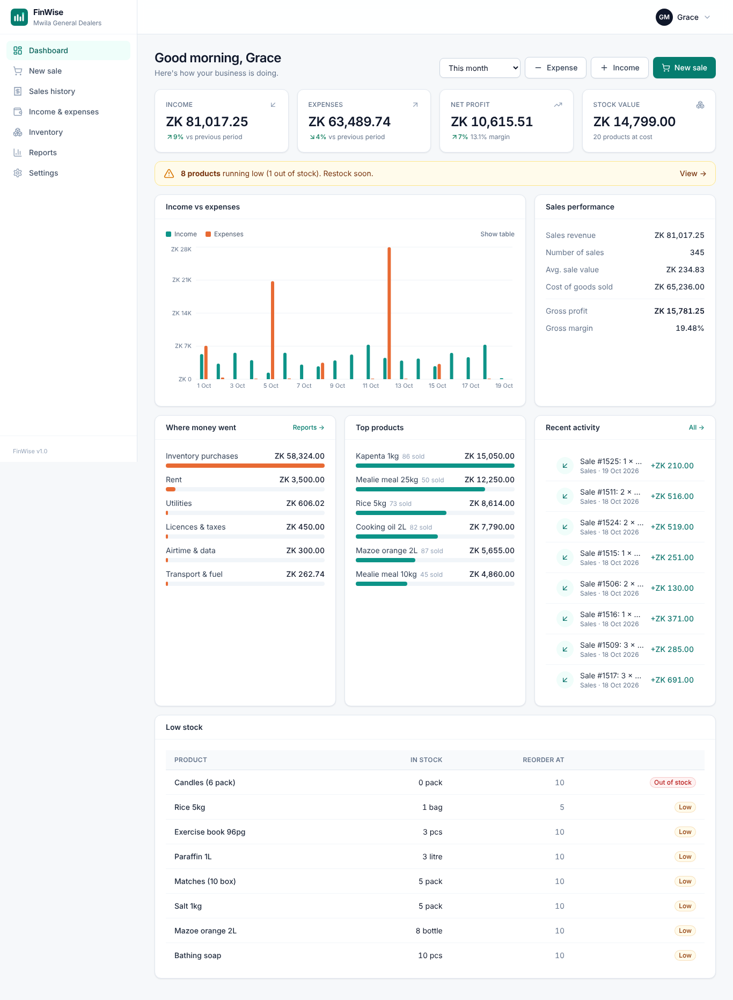

# FinWise

**Smart financial management for small businesses** — a Progressive Web App (PWA) to track income, expenses, sales and inventory from any device, even offline.

Built with **Next.js 14 (App Router) · TypeScript · MongoDB Atlas (Mongoose) · Tailwind CSS · Recharts**.



---

## Features

| Area | What it does |
|---|---|
| **Income & expenses** | Record money in/out by category, payment method (cash, mobile money, bank, card, credit), reference and date. Search & filter, edit/delete (owners), running totals. |
| **Point of sale** | Tap-to-add product grid, cart, discounts, customer name, payment method. Completing a sale **deducts stock, logs stock movements and posts income to the ledger in one atomic transaction**. Overselling is blocked. |
| **Receipts** | Printable / shareable receipt (Web Share or clipboard — handy for WhatsApp). Owners can **void** a sale: stock is returned and income reversed. |
| **Inventory** | Products with SKU, category, unit, cost & selling price, margin preview, reorder level. Receive stock (weighted-average costing, optional purchase expense), write-offs/adjustments, full stock history, archive. Low/out-of-stock alerts. |
| **Dashboard** | Income, expenses, net profit, stock value — with % change vs previous period. Income-vs-expenses chart (with table view), sales performance, where money went, top products, recent activity, low stock. |
| **Reports** | Profit & loss statement (revenue → COGS → gross profit → operating expenses → net profit), cash-flow statement, category breakdowns, product performance with margins, inventory position. Any date range. **CSV export** (transactions, sales, inventory) and print-to-PDF. |
| **Team & roles** | Owner invites staff with a temporary password (forced change on first login). **Staff** can sell, record income/expenses and view stock — but can't see reports, profits, other people's entries, or settings. Deactivate any time (sessions are cut off immediately). |
| **Multi-currency** | Each business picks its currency at signup (ZMW, ZAR, USD, KES, NGN, GHS … 17 options). |
| **PWA / offline** | Installable on Android, iOS and desktop. Service worker caches the app shell, pages and last-seen data. **Income/expense entries recorded offline are queued in IndexedDB and auto-synced** (idempotent — no duplicates). |
| **Security** | bcrypt password hashing, signed httpOnly JWT session cookies, per-route permission checks, strict business (tenant) isolation on every query, Zod input validation, login rate limiting, security headers. |

## Quick start

**Prerequisites:** Node.js 18.18+ (20 LTS recommended) and a MongoDB Atlas cluster (free M0 tier is fine).

```bash
npm install
cp .env.example .env.local     # then fill in MONGODB_URI and AUTH_SECRET
npm run seed                   # optional: demo business with 90 days of data
npm run dev                    # http://localhost:3000
```

Demo logins after seeding:

| Role | Email | Password |
|---|---|---|
| Owner | `demo@finwise.app` | `Demo@1234` |
| Staff | `staff@finwise.app` | `Staff@1234` |

> The service worker only registers in production builds. To test the PWA/offline features locally run `npm run build && npm start`.

## Scripts

| Command | Purpose |
|---|---|
| `npm run dev` | Development server |
| `npm run build` / `npm start` | Production build / serve |
| `npm run lint` / `npm run typecheck` | ESLint / TypeScript checks |
| `npm run seed` | Seed demo data (`-- --reset` to recreate) |
| `node scripts/smoke-test.mjs` | 44-check end-to-end API test against a running server (`BASE_URL=…`) |
| `npm run icons` | Regenerate PWA icons (Python + Pillow) |

## Environment variables

| Variable | Required | Description |
|---|---|---|
| `MONGODB_URI` | ✅ | Atlas connection string (include the database name, e.g. `/finwise`) |
| `AUTH_SECRET` | ✅ | Long random string for signing sessions (16+ chars; 48+ recommended) |
| `NEXT_PUBLIC_APP_URL` | – | Public URL of the deployment |

## Project structure

```
src/
  app/
    (auth)/login, signup        Public auth pages
    (app)/                      Authenticated app (layout loads session + business)
      dashboard, transactions, sales, sales/new, sales/[id],
      inventory, inventory/[id], reports, settings
    api/                        REST route handlers (see docs/TECHNICAL.md)
    offline/                    Offline fallback page
  components/                   UI kit, app shell, charts, modals, PWA hooks
  hooks/useApi.ts               Data-fetching hook
  lib/
    api.ts                      Route wrapper: DB, auth, permissions, errors
    auth.ts, session.ts         JWT session helpers
    permissions.ts              Role → permission map
    db.ts                       Cached Mongoose connection + transaction helper
    services/                   Business logic: sales, inventory, reports
    validators.ts               Zod schemas
    client.ts                   Browser API client + offline outbox (IndexedDB)
  models/                       Mongoose schemas
  middleware.ts                 Page-level auth & role redirects
public/
  sw.js, manifest.webmanifest, icons/
scripts/
  seed.ts, smoke-test.mjs, generate_icons.py
docs/
  USER_GUIDE.md, TECHNICAL.md, DEPLOYMENT.md, TESTING.md, PRESENTATION.md
```

## Documentation

- **[User guide](docs/USER_GUIDE.md)** — for business owners and staff
- **[Technical documentation](docs/TECHNICAL.md)** — architecture, data model, API, accounting logic, security, offline design
- **[Deployment guide](docs/DEPLOYMENT.md)** — MongoDB Atlas + Vercel or Render, step by step
- **[Testing](docs/TESTING.md)** — automated smoke test + manual test plan
- **[Presentation & demo script](docs/PRESENTATION.md)** — for the live demonstration

## Scope

**In scope (delivered):** transaction management, inventory integrated with sales, analytics & reports, PWA (installable, offline caching, offline entry queue), multi-user roles.

**Out of scope / future enhancements:** tax calculations, payroll, native app-store apps — plus ideas in [TECHNICAL.md › Roadmap](docs/TECHNICAL.md#roadmap).
